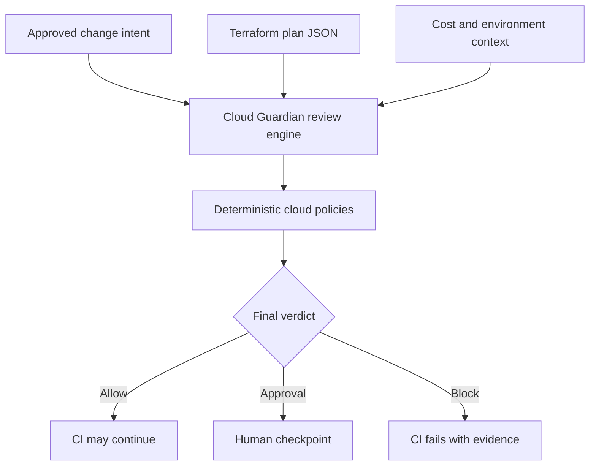

# Cloud Change Control Plane

An intent-aware policy gate for Terraform changes.

The control plane compares:

1. What a human approved in a change request.
2. What a Terraform plan will actually change.
3. The difference in resource count, action scope, environment, irreversibility,
   security exposure, and estimated cost.

It then returns one machine-enforceable verdict:

- `ALLOW`
- `REQUIRE_APPROVAL`
- `BLOCK`

Every verdict comes from deterministic policy rules. An LLM is not trusted to
make the enforcement decision.

## Why this project exists

A change request might approve one development S3 bucket while the generated
Terraform plan also opens SSH to the internet, grants wildcard IAM access, or
deletes a production database. Traditional syntax validation cannot determine
whether the plan exceeds the human-approved intent.

Cloud Change Control Plane performs that pre-apply authorization check.

## Architecture



The local MVP has no AWS dependency and costs $0 to run.

## Current policy checks

- Actual environment differs from the approved environment.
- Total resource changes exceed the approved count.
- Creates, updates, replacements, or deletes fall outside the approved actions.
- Terraform resource types fall outside the approved scope.
- Destructive changes exceed the approved delete count.
- Stateful resources are deleted or replaced without explicit permission.
- A plan exposes `0.0.0.0/0` or `::/0`.
- An IAM policy contains wildcard actions or resources.
- Estimated monthly cost exceeds the approved amount.
- Non-stateful replacements require a human checkpoint.

## Quick start

Requirements:

- Python 3.11+

The package has no runtime dependencies outside the Python standard library.

```bash
python -m venv .venv
source .venv/bin/activate
python -m pip install -e ".[dev]"
```

Run the safe example:

```bash
cloud-guardian review \
  --intent examples/intents/safe-change.json \
  --plan examples/plans/safe-plan.json \
  --cost-delta 1.25
```

Expected decision:

```text
ALLOW  CHG-1042
Create one encrypted asset bucket in development
Changes: create=1, update=0, delete=0, replace=0, total=1
```

Run the dangerous example:

```bash
cloud-guardian review \
  --intent examples/intents/safe-change.json \
  --plan examples/plans/dangerous-plan.json \
  --environment production \
  --cost-delta 120
```

It is blocked for independent reasons including environment mismatch, excessive
scope, public SSH, wildcard IAM, production database deletion, and cost.

## Generate a review from Terraform

```bash
terraform plan -out=tfplan
terraform show -json tfplan > tfplan.json

cloud-guardian review \
  --intent change-intent.json \
  --plan tfplan.json \
  --environment dev \
  --json \
  --output reports/guardian-report.json
```

The CLI exit codes are designed for CI:

| Verdict | Exit code | CI behavior |
| --- | ---: | --- |
| `ALLOW` | 0 | Continue |
| `REQUIRE_APPROVAL` | 2 | Pause/fail pending approval |
| `BLOCK` | 3 | Stop deployment |
| Invalid input | 1 | Stop and fix pipeline input |

## Change intent format

```json
{
  "request_id": "CHG-1042",
  "summary": "Create one encrypted asset bucket in development",
  "environment": "dev",
  "allowed_actions": ["create"],
  "allowed_resource_types": ["aws_s3_bucket"],
  "max_resource_changes": 1,
  "max_deletes": 0,
  "allow_stateful_deletes": false,
  "allow_public_ingress": false,
  "max_monthly_cost_delta_usd": 5.0
}
```

## Development

```bash
make install
make lint
make typecheck
make test
make build
```

The test suite includes allow, approval, and block scenarios and enforces at
least 85% branch-aware coverage.

## Security model

Deterministic rules make enforcement decisions. Future AI functionality may
explain findings or summarize a change, but it will not override a blocking
policy. See [Threat Model](docs/threat-model.md).

## Roadmap

### V0.2 — Pull request enforcement

- GitHub App or reusable workflow.
- Pull request review comments.
- OPA/Rego policy bundles.
- Infracost JSON ingestion.
- Signed review artifacts.

### V0.3 — Zero-cost AWS audit layer

- GitHub-to-AWS OIDC.
- Lambda review API.
- DynamoDB decision ledger.
- S3 evidence archive.
- EventBridge notifications and automatic expiry.
- CloudWatch metrics and alarms.

### V0.4 — Drift and autonomous operations

- AWS Config and CloudTrail drift events.
- Safe runbook recommendations.
- Human-approved remediation.
- SLO and policy-effectiveness dashboards.

## Project status

V0.1 local MVP. It reviews Terraform plan JSON, applies deterministic cloud
policies, emits machine-readable evidence, and is covered by automated quality
gates.

## License

MIT
